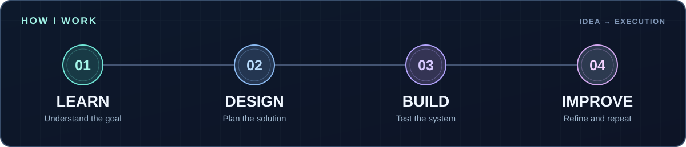

 

&nbsp;&nbsp;

 

## 01 / About

**Hi, I'm Kothakota Rakesh.** I study **Artificial Intelligence & Machine Learning** at **Saveetha Institute of Medical and Technical Sciences, Chennai**, and I enjoy transforming technical ideas into useful digital experiences.

I’m focused on **full-stack web development, applied machine learning, algorithms, and cybersecurity**. My approach is simple: understand a problem, design carefully, build something that works, and keep improving it.

> **What drives me:** Curiosity, hands-on learning, thoughtful design, and collaborating with people who love to build.

## 02 / Technical toolkit

These are technologies I work with or am actively learning, not a claim of equal proficiency in every tool.

## 03 / How I work

I believe great software should be **useful, understandable, and maintainable**. I’m always exploring ways to make applications faster, clearer, and more accessible.

 

