 

&nbsp;

 

### GitHub activity

Snapshot taken 28 November 2026 from public repository commit history. It shows **134 authored commit records across 9 public repositories**, activity in **6 of 12 months**, and a chart of the **8 most recent dates with commits**. This is not GitHub's official contribution total and will not update automatically. The current contribution calendar is available farther down on your GitHub profile.

 

### Hi, I'm Rakesh.

I'm studying **Artificial Intelligence & Machine Learning** at **Saveetha Institute of Medical and Technical Sciences, Chennai**.

I enjoy building things for the web and understanding the logic behind them. My interests sit somewhere between clean interfaces, Python backends, machine learning, and solving problems with algorithms.

### What I work with

| Area | Technologies & interests |
| :--- | :--- |
| **Web interfaces** | JavaScript, HTML, CSS, React, Next.js |
| **Backend & data** | Python, FastAPI, Flask, SQL, REST APIs |
| **AI & fundamentals** | Machine learning, C, data structures, graph algorithms |
| **Development tools** | Git, GitHub, Docker, VS Code |

### A little more about me

- I prefer **building and testing working applications** to stopping at the idea stage.
- I'm interested in **cybersecurity**, hackathons, and finding better ways to solve practical problems.
- I’m always learning, especially where software engineering and AI overlap.

---

Based in India · B.Tech AI/ML · Learning by building
