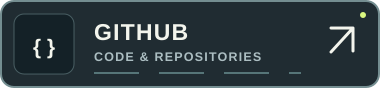
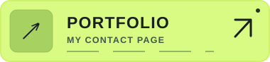
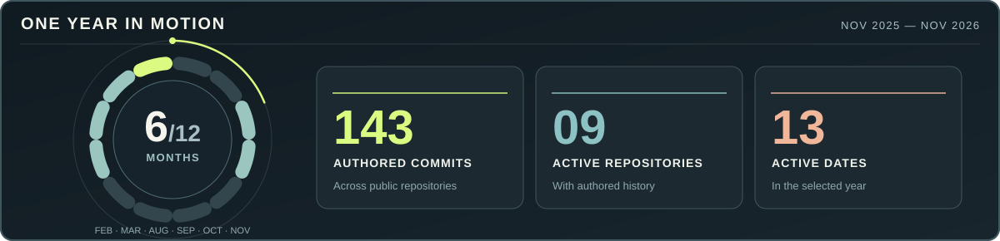
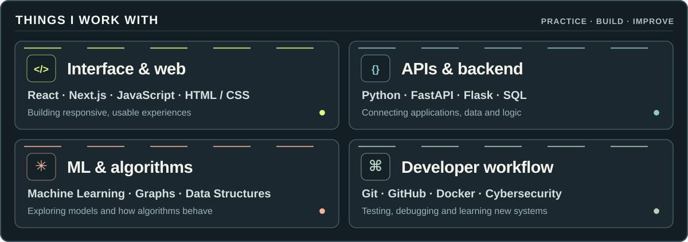
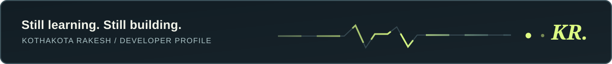

 

&nbsp;&nbsp;

### A little about me

I'm **Kothakota Rakesh**, a B.Tech **Artificial Intelligence & Machine Learning** student at **Saveetha Institute of Medical and Technical Sciences, Chennai**.

I enjoy building full-stack applications and figuring out how things work behind the interface. Most of my learning happens by writing code, testing ideas, fixing problems, and making the next version better.

### GitHub activity

**Data source:** Public GitHub repository commit history, collected **28 November 2026 (UTC)** before the V8 updates: **143 authored commit records**, **9 repositories with authored commits**, **13 active dates**, and **6 active months** in the previous year. The graph shows only the eight most recent dates with commits. These are historical commit records, **not GitHub's official contribution totals**, and the graphics do not update automatically.

### Tools I use and explore

I'm particularly interested in **Python, React, FastAPI, machine learning, graph algorithms and cybersecurity**. The toolkit includes technologies I'm using or actively learning.

### Beyond the code

I like taking ideas beyond a demo screen—connecting a usable interface to real logic, checking the results and learning from what breaks. Hackathons and academic work are opportunities to practise that process.

 

