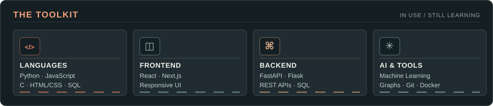

 

&nbsp;

### Hello, I'm Rakesh.

I'm a B.Tech **Artificial Intelligence & Machine Learning** student at **Saveetha Institute of Medical and Technical Sciences, Chennai**.

I enjoy building full-stack web applications, working with Python, and exploring how machine learning and algorithms can solve practical problems. I'm particularly interested in creating useful software with clear, responsive interfaces.

### Activity on GitHub

**Data note:** This is a snapshot of public repository history as of **28 November 2026 (UTC)**: **134 authored commits** in **9 public repositories**, across **13 active dates** and **6 active months**. The chart displays the eight most recent active dates. Counts are not GitHub's official contribution total and do not update automatically.

### My toolkit

These are tools I use or am actively learning, not a claim of equal proficiency in each one.

### A little more about me

- I like turning a project idea into a **working application** and improving it through testing.
- I enjoy exploring **algorithms, cybersecurity, and machine learning** alongside web development.
- My goal is to grow into a developer who builds software that people can rely on.

---

Based in India · Learning by building
