 

&nbsp;&nbsp;

 

###  &nbsp; About me

> **I turn ideas into practical, intuitive digital experiences.**
>
> A B.Tech **Artificial Intelligence & Machine Learning** student at **Saveetha Institute of Medical and Technical Sciences, Chennai**, exploring the intersection of full-stack engineering, machine learning and thoughtful interface design.

- 🧠 **I enjoy:** AI/ML, algorithms, problem solving and cybersecurity
- 💻 **I build with:** Python, JavaScript, React, FastAPI and databases
- 🧪 **My approach:** Learn → experiment → build → improve
- 🤝 **I'm interested in:** Collaboration, research and hackathons

###  &nbsp; Technology stack

###  &nbsp; GitHub insights

Language cards describe the public repositories GitHub detects, not a ranking of proficiency. Statistics are supplied by an external service and may occasionally be unavailable.

 

