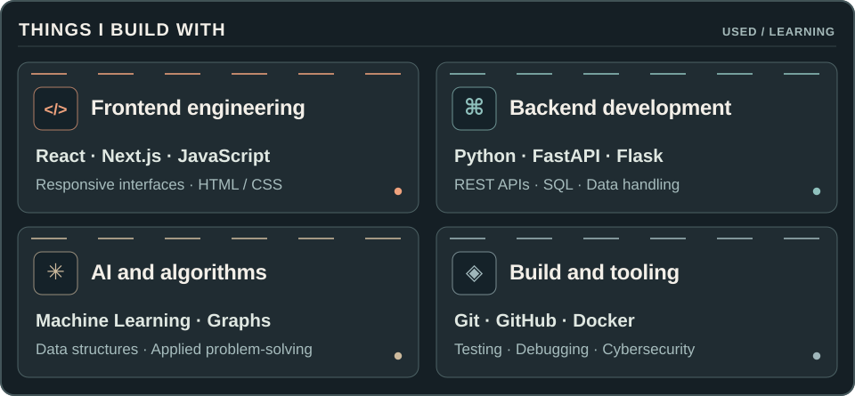

 

&nbsp;

### Hi, I'm Rakesh.

I'm a B.Tech **Artificial Intelligence & Machine Learning** student at **Saveetha Institute of Medical and Technical Sciences, Chennai**.

I enjoy turning ideas into working web applications, learning how systems behave behind the interface, and exploring what machine learning and algorithms can do in practice.

### GitHub, in numbers

**Activity snapshot — 28 Nov 2026 (UTC), before the profile redesign commits:** 143 authored commit records in 9 public repositories, across 13 active dates and 6 active months. The bars show the eight most recent dates with commits. This is **not GitHub's official contributions total** and does not update automatically. The native GitHub contribution calendar is visible below this README.

### What I work with

These are technologies I use or am actively learning, not a claim of equal proficiency in every tool.

### The way I learn

I prefer building, testing, and improving something real. Whether it's a small web feature or an AI experiment, I like understanding **why it works**, not only getting it to run.

 

